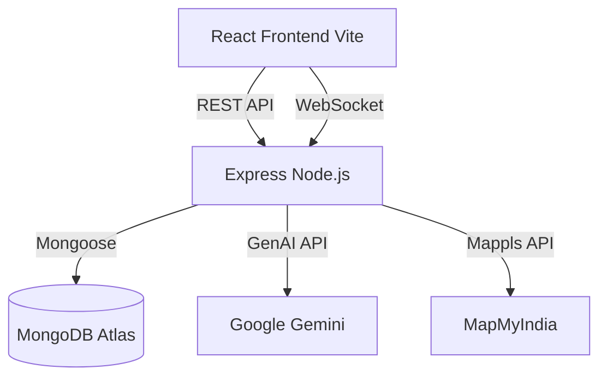

# ♻️ IndusCycle Codebase Walkthrough

Welcome to the **IndusCycle** project! This walkthrough provides a comprehensive guide to understanding the architecture, core features, and directory structure of this Intelligent B2B Marketplace for Industrial Waste Exchange. 

> [!TIP]
> This guide is intended for developers who are onboarding to the project or looking to understand the technical implementation of specific features.

---

## 🏗️ Architecture Overview

The application follows a standard modern MERN stack architecture (MongoDB, Express, React, Node.js) split into two distinct parts:
1. **Frontend (`/client`)**: Built with React 19 and Vite 7, styled using Tailwind CSS 4, and routing handled via React Router.
2. **Backend (`/server`)**: A Node.js/Express REST API utilizing MongoDB Atlas as its datastore (via Mongoose), with integrated Socket.io for real-time capabilities.



---

## 📂 Codebase Structure 

### 🖥️ Client (Frontend)

The frontend uses Vite as the bundler. The entry point is `client/src/main.jsx`, which renders the React tree inside `client/src/App.jsx`.

- **`src/App.jsx`**: Configures global providers (`ThemeProvider`, `AuthProvider`) and sets up React Router.
  - Public routes: `/` (Landing), `/login`, `/register`.
  - Protected routes: Wrapped in a `<ProtectedRoute>` component (e.g., `/dashboard`, `/deals`, `/logistics`).
- **`src/pages/`**: Contains page-level components corresponding to the routes. 
  - `Dashboard.jsx`: The command center.
  - `DealFlow.jsx`: UI for managing and negotiating deals.
  - `Logistics.jsx`: Map-based transporter discovery.
- **`src/context/`**: State management, primarily `AuthContext` for handling JWT tokens and user sessions.
- **`src/components/`**: Reusable UI elements (Buttons, Cards, Theme Toggles).

### ⚙️ Server (Backend)

The Node.js Express server is instantiated in `server/index.js`. 

- **`index.js`**: Connects to MongoDB, sets up Express middleware (CORS, JSON parsing), configures the API routes, and initializes the Socket.io server. It also contains proxies for Mappls API to bypass CORS during development/production.
- **`routes/`**: Contains Express Router configurations for all domains.
  - `auth.js`, `deals.js`, `factories.js`, `requirements.js` (handles the AI Matching via Gemini).
- **`models/`**: Mongoose schemas defining the data layer structure (e.g., `Users`, `Factories`, `Deals`, `Messages`).
- **`config/database.js`**: Handles connecting to MongoDB Atlas.

---

## 🚀 Core Features Deep Dive

### 1. 🤖 AI-Powered Matching (Gemini)
When a buyer needs a specific material, they use the "AI Match" feature. This is handled in the `requirements.js` route. 
- The server pulls marketplace listings and buyer requirements.
- It queries the **Google Gemini API** (`@google/genai`) to score and rank listings based on material match, volume compatibility, and geographic proximity.
- Results are returned to the client with a match percentage and reasoning, allowing buyers to initiate a "Fast Deal".

### 2. 🤝 Deal Flow & Socket.io Chat
Deals (`deals.model.js`) represent an agreement between a buyer and a seller.
- **Real-Time Negotiation**: Socket.io is used for real-time chatting within a deal context. 
- In `server/index.js`, socket listeners for `join_chat`, `send_message`, and `leave_chat` manage room-based communication.
- When a `send_message` event is triggered, the server persists the message using `Message.create` and broadcasts it to the room via `io.to(dealRoom).emit("chat_message")`.

### 3. 🚚 Map Integration & Logistics
The frontend utilizes MapMyIndia (Mappls) for transporter discovery.
- Because of CORS restrictions, `server/index.js` provides proxy endpoints (`/mappls-auth` and `/mappls-search`).
- The `Logistics.jsx` page fetches nearby courier services and visualizes the route between the source factory and the destination.

### 4. 📝 Auto-Generated Compliance Docs
For completed waste exchanges, the system generates a regulatory compliance document.
- The `GET /api/deals/:id/compliance-pdf` endpoint uses **PDFKit** to build a comprehensive PDF containing buyer/seller details, material profiles, and environmental impact (CO₂ saved).

---

## ⚡ Getting Started Locally

> [!WARNING]
> You must ensure you have valid API keys for MongoDB, Google Gemini, and a JWT Secret to run this project.

1. **Environment Setup**:
   Create a `.env` in the `/server` directory:
   ```env
   PORT=4000
   JWT_SECRET=your_jwt_secret
   MONGO_URI=your_mongo_connection_string
   GEMINI_API_KEY=your_gemini_key
   ```
   Create a `.env` in the `/client` directory:
   ```env
   VITE_API_URL=http://localhost:4000
   ```

2. **Install & Run**:
   You will need two terminals running concurrently.
   
   **Terminal 1 (Backend)**:
   ```bash
   cd server
   npm install
   npm run dev
   ```

   **Terminal 2 (Frontend)**:
   ```bash
   cd client
   npm install
   npm run dev
   ```

3. **View App**:
   Navigate to `http://localhost:5173` in your browser.

---

> [!NOTE]
> If you have further questions or want to implement new features, checking the schemas in `server/models/` and the UI components in `client/src/pages/` is a great place to start!
